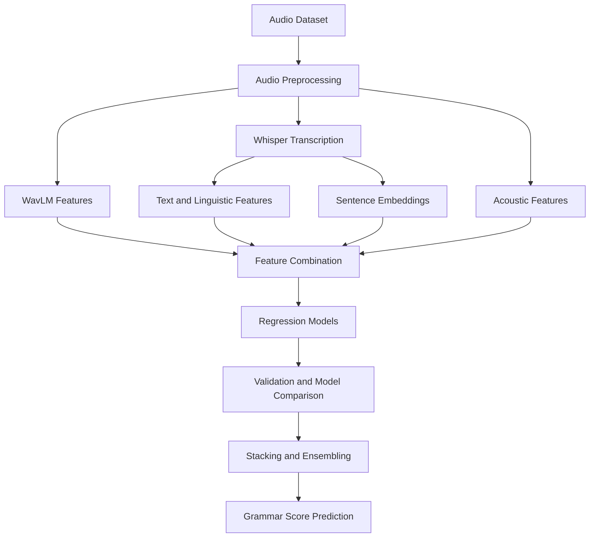

# SHL Grammar Scoring Engine

A machine learning project for predicting spoken-English grammatical proficiency from audio recordings. This project explores speech representations, automatic speech recognition, linguistic feature engineering, and ensemble regression to estimate grammar scores on a continuous 0–5 scale.

The goal is to investigate how combining complementary audio and text representations can improve generalization on a small, labelled speech dataset.

## Project Overview

Automated grammar assessment from speech is challenging because a recording contains more than grammatical information. It includes pronunciation, pauses, disfluencies, transcription errors, and variations in sentence structure.

This project investigates a multimodal approach that combines pretrained speech representations, transcribed text, linguistic statistics, and classical machine learning models.

The work is organized around iterative experimentation: establishing a baseline, exploring richer feature representations, comparing regressors, and evaluating stacking approaches using cross-validation.

## Workflow

## Dataset

The competition dataset contains:

- **769 labelled training audio recordings**
- **216 test audio recordings**
- A continuous grammar-scoring target on a 0–5 scale

The audio files are used to extract speech representations, acoustic information, and text-based features.

The original dataset is not included in this repository. Access it through the relevant competition source and configure the notebook to use the required training and test files.

## Current Approach

The main experimental notebook is:

[`Grammar_Scoring_from_Speech_Whisper_WavLM_Stacking.ipynb`](Grammar_Scoring_from_Speech_Whisper_WavLM_Stacking.ipynb)

### 1. Speech Representations

Pretrained WavLM representations are used to capture information from the audio signal. Chunk-based pooling can help represent recordings that contain changes in speaking patterns and sentence structure over time.

These representations provide learned speech features without requiring the entire speech encoder to be trained from scratch.

### 2. Automatic Speech Recognition

Whisper is used to transcribe spoken recordings into text.

The resulting transcripts provide a text representation of the spoken response, allowing the model to explore linguistic patterns alongside audio features.

ASR transcripts are imperfect: transcription systems can omit, normalize, or introduce errors. Consequently, transcript-derived information is treated as a useful signal rather than ground truth.

### 3. Linguistic and Text Features

Text-derived features capture patterns that may be relevant to grammatical proficiency, including:

- Sentence length and sentence-level statistics
- Lexical diversity and word-level patterns
- Fillers, repetitions, and disfluencies
- Clause markers and conjunctions
- Sentence embeddings that represent semantic and linguistic information

Acoustic and prosodic statistics may also contribute information about the recordings that is not fully represented by the transcript.

### 4. Regression Models

The experiments explore complementary regression approaches, including:

- **Ridge Regression** — a regularized linear model for high-dimensional features
- **Support Vector Regression (SVR)** — a nonlinear regression approach using an RBF kernel
- **Extra Trees Regressor** — an ensemble of randomized decision trees
- **Histogram-based Gradient Boosting** — a boosting-based regression approach
- **Stacking** — a meta-model that combines predictions from multiple base regressors

The objective is not simply to use more models, but to identify which representations and regressors provide reliable improvements.

## Model Evaluation

Evaluation is a central part of this project because a model can perform well on its training data without generalizing to unseen recordings.

The experimental workflow uses nested cross-validation to evaluate candidate models and stacking configurations.

The evaluation considers:

- **Root Mean Squared Error (RMSE):** measures the magnitude of prediction errors; lower is better.
- **Pearson correlation:** measures the linear association between predictions and reference scores; higher is better.
- **Fold-level consistency:** helps identify models whose results depend heavily on a particular split.
- **Training RMSE:** reported separately where required, but not treated as a substitute for cross-validation.

Nested stacking uses inner-fold predictions to train the meta-model and separate outer folds to estimate generalization. This helps reduce the optimistic bias that can arise when a stacking model is evaluated on the same predictions used to train it.

Final model selection should be based on validation evidence rather than model complexity alone.

## Earlier Baseline

The initial project explored Wav2Vec2 embeddings with Ridge Regression.

The earlier baseline reported:

| Metric | Baseline result |
|---|---:|
| Five-fold validation RMSE | 0.6951 |
| Five-fold Pearson correlation | 0.8277 |
| Training RMSE | 0.4927 |
| Competition leaderboard score | 0.5718 |
| Reported leaderboard rank | 232 |

These figures describe the earlier baseline, not the current Whisper–WavLM stacking notebook.

Results from different validation procedures should not be compared as if they were measured under identical conditions. The current experimental results will be documented separately after the notebook has been run and the final evaluation procedure confirmed.

## Reproducibility and Runtime

The notebook is designed for a GPU-enabled Kaggle or Google Colab environment.

The workflow may require:

- Python
- PyTorch
- Hugging Face Transformers
- librosa and soundfile
- sentence-transformers
- scikit-learn
- NumPy and pandas
- SciPy and tqdm

Pretrained model weights may need to be downloaded when the notebook runs for the first time. Audio feature extraction and transcription can be computationally expensive.

Extracted features and transcripts may be cached to avoid repeating expensive processing steps. Dataset paths and runtime configuration should be adjusted for the environment being used.

For reproducible comparisons, keep the random seed, validation procedure, and preprocessing configuration consistent across experiments.

## Limitations

- The labelled dataset is relatively small, making overfitting a significant risk.
- Speech recognition errors can affect text-based features.
- Pretrained speech representations may capture information beyond grammar, including speaker and recording characteristics.
- Ensemble complexity does not guarantee better generalization.
- Cross-validation performance does not guarantee a corresponding improvement on the competition leaderboard.
- Performance estimates can vary with the validation split and evaluation procedure.

## Current Development Status

This repository is an ongoing experimental project.

The current focus is on improving feature representations, comparing individual regressors, testing stacking strategies, and validating whether additional complexity produces measurable gains.

The experimental notebook will continue to be updated as new results become available. A consolidated final notebook and a more structured repository layout will be prepared once the experimentation phase is complete.

## Repository

GitHub: [Kintsulios/SHL-Grammar-Scoring](https://github.com/Kintsulios/SHL-Grammar-Scoring)

The project aims to demonstrate a systematic machine learning workflow: feature extraction, model comparison, validation, error analysis, and evidence-based model selection.
